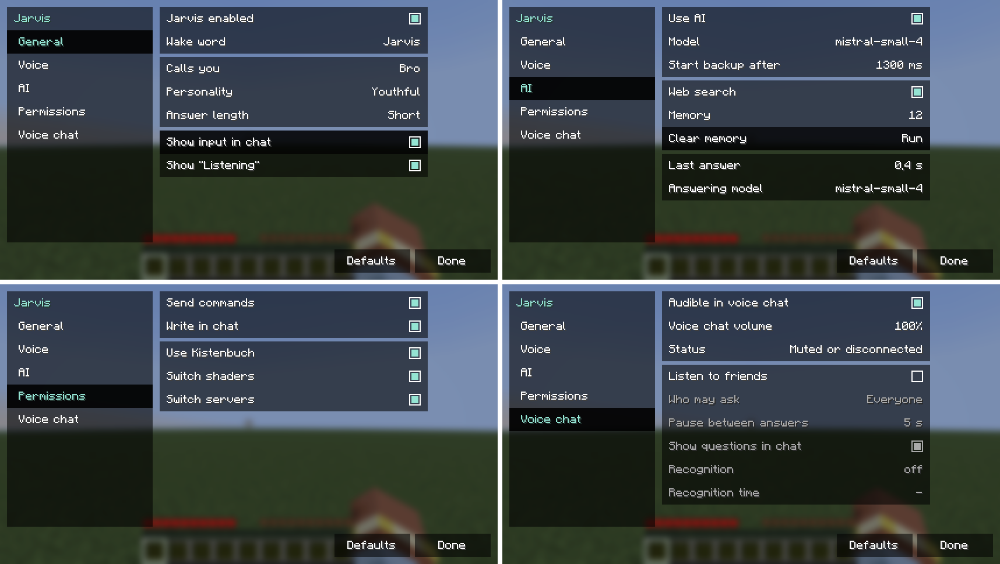

<p align="center">
  
</p>

<h1 align="center">Jarvis Client Assistant</h1>

<p align="center">
  An AI assistant right inside your Minecraft client.<br>
  Ask questions, search the web, send commands and talk in voice chat, without the server needing the mod.
</p>

<p align="center">
  <a href="https://github.com/Lenno70270/jarvis-client-assistant/releases/latest"></a>
  
  
  
  
</p>

---

Jarvis answers anything like a search engine, talks to you and in voice chat, and sends commands for you. Your player
always stays yours: Jarvis never walks, builds, fights or opens chests.

> **Language:** The menu is in English and German, depending on your game language. Jarvis himself currently answers
> in German, and the local voices and speech recognition are German too.

## How to use

| Input | What happens |
| --- | --- |
| `Jarvis ...` in chat | Only you see it, the server never gets the message |
| Hold **J** | Talk, Jarvis answers with his voice |
| **K** | Open the menu, with a tooltip for every setting |
| `Jarvis stopp` | Cancels the current answer |

**Examples**

```text
Jarvis erzähl mir einen Witz              (tell me a joke)
Jarvis wie wird das Wetter morgen in Berlin?
Jarvis schick mich zum Spawn             (send me to spawn)
Jarvis /home                             ← runs instantly, without the AI
Jarvis mach BSL an                       (turn on the BSL shader)
```

## The menu

Press **K** to open all settings, laid out like the Sodium options.



<sub>In-game screenshots: General, AI, Permissions and Voice chat.</sub>

## What he can do

| | |
| --- | --- |
| 💬 **Answer** | Jokes, knowledge, advice, conversation |
| 🔎 **Look things up** | Web search via DuckDuckGo with Wikipedia as fallback, weather via Open-Meteo, an exact calculator |
| ⌨️ **Commands and chat** | Reads the server's reply and fixes mistakes on his own |
| 🎙️ **Voice chat** | With Simple Voice Chat, nearby players hear Jarvis through your voice channel while you're connected and not muted |
| 🖥️ **Client** | Switch Iris shaders, switch between saved servers |

## Installation

1. Install [Fabric Loader](https://fabricmc.net/use/) for Minecraft 26.2 (Java 25)
2. Put [Fabric API](https://modrinth.com/mod/fabric-api) into your `mods` folder
3. Add `jarvis-client-assistant-….jar` from the [releases](https://github.com/Lenno70270/jarvis-client-assistant/releases/latest)
4. Set up the AI (see below)

Optional: [Simple Voice Chat](https://modrinth.com/mod/simple-voice-chat) so others hear Jarvis,
[Iris](https://modrinth.com/mod/iris) for shader control.

## Setting up the AI

The settings live in `config/jarvis.json`:

```json
{
  "baseUrl": "https://your-provider.example/v1",
  "apiKey": "your-key",
  "model": "model-name",
  "fallbackModels": ["second-model", "third-model"]
}
```

Jarvis works with any OpenAI-compatible service, for example a commercial provider or your own server with LiteLLM,
Ollama or LM Studio. He uses `/chat/completions`, `/audio/transcriptions` for voice input and `/audio/speech` for the
cloud voice. Without a `baseUrl`, only fixed commands like `Jarvis /home` work.

If a model doesn't answer within 1.3 seconds or refuses, the next one starts in parallel. The first answer wins. If
all of them fail, only fixed commands like `Jarvis /home` still work.

## Permissions

Jarvis quietly checks whether you're in singleplayer or on a server and what you're allowed to do there. He only
reads the command list the server sends to your client anyway. If you lack the permissions, he blocks operator
commands like `/gamemode`, `/give` or `/tp`, and nothing is sent to the server. Commands like `/home` or `/tpa` stay
available.

## Friends in voice chat

In the menu under Voice chat you can turn on "Listen to friends". It's off by default. When someone in voice chat
then says "Jarvis, ...", Jarvis answers through your voice channel.

- Recognition runs locally with [whisper.cpp](https://github.com/ggml-org/whisper.cpp) from
  `%LOCALAPPDATA%\Jarvis\whisper`. Voices never leave your PC and are never saved.
- Only the sentence after the wake word goes to the AI.
- Friends only get answers and lookups. Commands, chat, your inventory and your position are locked for them, even
  if the AI tries.
- Tell your friends beforehand that Jarvis is listening.

## Voices

The voices run locally with [Piper](https://github.com/rhasspy/piper) and are trained on German. There's no limit and
nothing goes to the internet. Piper and the voices live in `%LOCALAPPDATA%\Jarvis\piper`. Without that folder, Jarvis
uses a cloud voice.

## Kistenbuch

If the Kistenbuch mod is installed, Jarvis finds your items: `Jarvis wo sind meine Diamanten?` (where are my
diamonds?) or `Jarvis markier die Kiste mit dem Eisen` (mark the chest with the iron). This only works for you.
Friends in voice chat have no access to it.

## Limits

- What you ask and your inventory go to the AI service, search terms go to DuckDuckGo.
- The AI is told to ask before risky commands. That's an instruction, not a hard lock.
- In voice chat, Jarvis sounds to others as if it came from you.
- Voice input runs through the configured AI service and therefore needs internet.
- Some servers don't allow automated commands. Check the rules first.

## Building and testing

The Simple Voice Chat API is only needed to compile and isn't in the repository. Download
`voicechat-api-2.6.27.jar` and put it into `libs/`. Then:

```bash
./gradlew build
./gradlew runClientGameTest
```

The test starts a real client and a real server. `JARVIS_TEST_CONFIG` turns on the real AI,
`-PextraMods=<mods folder>` loads Iris and Simple Voice Chat, and `JARVIS_TEST_SHADER` names a shader pack.

## License

MIT, see [LICENSE](LICENSE).
