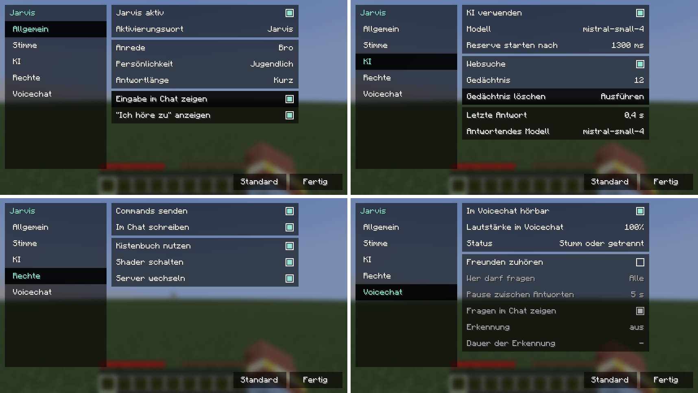

<p align="center">
  
</p>

<h1 align="center">Jarvis Client Assistant</h1>

<p align="center">
  Ein KI-Assistent direkt in deinem Minecraft-Client.<br>
  Fragen, googeln, Commands schicken und im Voicechat reden, ohne dass der Server die Mod braucht.
</p>

<p align="center">
  <a href="https://github.com/Lenno70270/jarvis-client-assistant/releases/latest"></a>
  
  
  
  
</p>

> **English:** A client-side AI assistant for Minecraft. Type `Jarvis ...` in chat or hold **J** and talk. Jarvis
> answers, searches the web and sends commands for you. Works with any OpenAI-compatible AI service.

---

Jarvis beantwortet alles wie eine Suchmaschine, redet mit dir und im Voicechat und sendet Commands für dich. Dein
Spieler bleibt immer bei dir: Jarvis läuft nicht, baut nicht, kämpft nicht und öffnet keine Truhen.

## Bedienen

| Eingabe | Was passiert |
| --- | --- |
| `Jarvis ...` im Chat | Nur du siehst das, der Server bekommt die Nachricht nicht |
| **J** gedrückt halten | Sprechen, Jarvis antwortet mit Stimme |
| **K** | Menü öffnen, mit Tooltips zu jeder Einstellung |
| `Jarvis stopp` | Bricht die laufende Antwort ab |

**Beispiele**

```text
Jarvis erzähl mir einen Witz
Jarvis wie wird das Wetter morgen in Berlin?
Jarvis wer ist aktuell Bundeskanzler?
Jarvis schick mich zum Spawn
Jarvis /home          ← geht direkt ohne KI und ist dadurch sofort da
Jarvis mach BSL an
```

## Das Menü

Mit **K** öffnest du alle Einstellungen, aufgebaut wie die Sodium-Optionen.



<sub>Screenshots aus dem Spiel: Allgemein, KI, Rechte und Voicechat.</sub>

## Was er kann

| | |
| --- | --- |
| 💬 **Antworten** | Witze, Wissen, Rat, Gespräche |
| 🔎 **Googeln** | Websuche über DuckDuckGo, Rückfall auf Wikipedia, Wetter über Open-Meteo, exakter Rechner |
| ⌨️ **Commands und Chat** | Er liest die Antwort des Servers und korrigiert Fehler selbst |
| 🎙️ **Voicechat** | Mit Simple Voice Chat hören Spieler in der Nähe Jarvis über deinen Sprachkanal, solange du verbunden und nicht stumm bist |
| 🖥️ **Client** | Iris-Shader schalten, gespeicherte Server wechseln |

## Installation

1. [Fabric Loader](https://fabricmc.net/use/) für Minecraft 26.2 installieren (Java 25)
2. [Fabric API](https://modrinth.com/mod/fabric-api) in den `mods`-Ordner legen
3. `jarvis-client-assistant-….jar` aus den [Releases](https://github.com/Lenno70270/jarvis-client-assistant/releases/latest) dazulegen
4. KI einrichten (siehe unten)

Optional: [Simple Voice Chat](https://modrinth.com/mod/simple-voice-chat) für Jarvis im Voicechat,
[Iris](https://modrinth.com/mod/iris) für die Shader-Steuerung.

## KI einrichten

Die Einstellungen liegen in `config/jarvis.json`:

```json
{
  "baseUrl": "https://dein-anbieter.example/v1",
  "apiKey": "dein-key",
  "model": "name-des-modells",
  "fallbackModels": ["zweites-modell", "drittes-modell"]
}
```

Jarvis funktioniert mit jedem OpenAI-kompatiblen Dienst, zum Beispiel einem kommerziellen Anbieter oder einem eigenen
Server mit LiteLLM, Ollama oder LM Studio. Gebraucht werden `/chat/completions`, für Spracheingabe
`/audio/transcriptions` und für die Cloud-Stimme `/audio/speech`. Ohne `baseUrl` laufen nur feste Befehle wie
`Jarvis /home`.

Antwortet ein Modell nicht innerhalb von 1,3 Sekunden oder lehnt ab, startet parallel das nächste. Die erste
Antwort gewinnt. Fallen alle aus, gehen nur noch feste Befehle wie `Jarvis /home`.

## Rechte

Jarvis prüft unsichtbar, ob du in einer Einzelspieler-Welt oder auf einem Server bist und was du dort darfst. Er
liest dafür nur die Command-Liste, die der Server deinem Client ohnehin schickt. Fehlen dir die Rechte, sperrt er
Op-Commands wie `/gamemode`, `/give` oder `/tp`, und nichts geht an den Server. Commands wie `/home` oder `/tpa`
bleiben frei.

## Freunde im Voicechat

Im Menü unter Voicechat lässt sich „Freunden zuhören" einschalten, standardmäßig ist es aus. Sagt dann jemand im
Voicechat „Jarvis, ...", antwortet Jarvis über deinen Sprachkanal.

- Die Erkennung läuft lokal mit [whisper.cpp](https://github.com/ggml-org/whisper.cpp) aus
  `%LOCALAPPDATA%\Jarvis\whisper`. Stimmen verlassen deinen PC nicht und werden nicht gespeichert.
- Nur der Satz nach dem Aktivierungswort geht an die KI.
- Freunde bekommen nur Antworten und Nachschlagen. Commands, Chat, dein Inventar und deine Position sind für sie
  gesperrt, auch wenn die KI es versuchen sollte.
- Sag deinen Freunden vorher, dass Jarvis zuhört.

## Stimmen

Die Stimmen laufen lokal mit [Piper](https://github.com/rhasspy/piper) und sind auf Deutsch trainiert. Es gibt
kein Limit, und nichts geht dafür ins Internet. Piper und die Stimmen liegen in `%LOCALAPPDATA%\Jarvis\piper`.
Ohne diesen Ordner nutzt Jarvis eine Cloud-Stimme.

## Kistenbuch

Ist die Mod Kistenbuch installiert, findet Jarvis deine Items: `Jarvis wo sind meine Diamanten?` oder
`Jarvis markier die Kiste mit dem Eisen`. Das gilt nur für dich. Freunde im Voicechat haben keinen Zugriff darauf.

## Grenzen

- Was du fragst und dein Inventar gehen an den KI-Dienst, Suchbegriffe an DuckDuckGo.
- Vor riskanten Commands soll die KI nachfragen. Das ist eine Anweisung, keine feste Sperre.
- Im Voicechat klingt Jarvis für andere, als käme es von dir.
- Die Spracheingabe läuft über den eingestellten KI-Dienst und braucht deshalb Internet.
- Manche Server erlauben keine automatischen Commands. Lies vorher die Regeln.

## Bauen und testen

Die Simple-Voice-Chat-API wird nur zum Kompilieren gebraucht und liegt nicht im Repository. Lade
`voicechat-api-2.6.27.jar` herunter und leg sie nach `libs/`. Dann:

```bash
./gradlew build
./gradlew runClientGameTest
```

Der Test startet einen echten Client und einen echten Server. `JARVIS_TEST_CONFIG` schaltet die echte KI dazu,
`-PextraMods=<Mod-Ordner>` lädt Iris und Simple Voice Chat, und `JARVIS_TEST_SHADER` nennt ein Shader-Paket.

## Lizenz

MIT, siehe [LICENSE](LICENSE).
